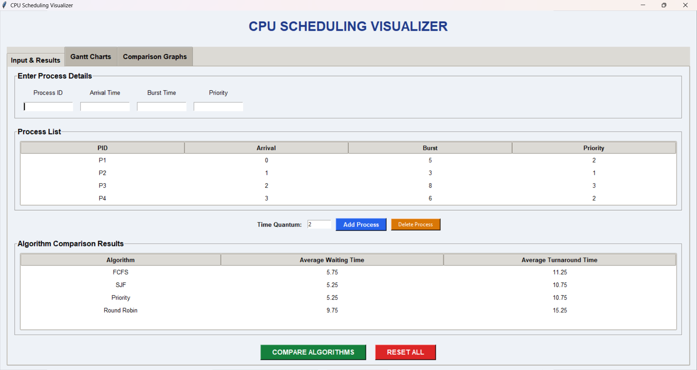
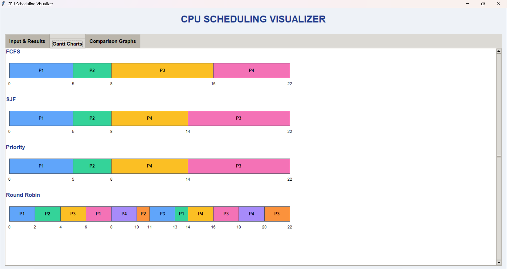
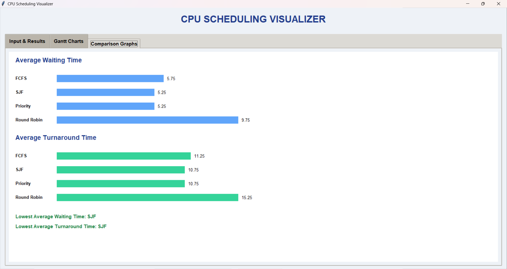

# CPU Scheduling Visualizer

## 1. Introduction

CPU Scheduling Visualizer is a Python-based desktop application developed using Tkinter. It demonstrates different CPU scheduling algorithms and helps users understand how processes are scheduled by the CPU.

The project calculates waiting time, turnaround time and completion time for each process. It also displays Gantt charts and comparison graphs to make algorithm performance easier to understand.

## 2. Objectives

- To understand different CPU scheduling algorithms.
- To calculate waiting time and turnaround time.
- To visualize process execution using Gantt charts.
- To compare the performance of different scheduling algorithms.
- To provide a simple and user-friendly graphical interface.

## 3. Technologies Used

- **Programming Language:** Python
- **GUI Library:** Tkinter
- **Data Visualization:** Tkinter Canvas
- **Development Tool:** Visual Studio Code

## 4. CPU Scheduling Algorithms Implemented

### 1. First Come First Serve (FCFS)
Processes are executed in the order in which they arrive.

### 2. Shortest Job First (SJF)
The process with the shortest burst time is selected first among the available processes. This project uses Non-Preemptive SJF.

### 3. Priority Scheduling
The process with the highest priority is executed first. A smaller priority number represents a higher priority. This project uses Non-Preemptive Priority Scheduling.

### 4. Round Robin (RR)
Each process gets a fixed amount of CPU time called Time Quantum. If a process is not completed, it goes back to the ready queue.

## 5. Features

- Add and delete processes.
- Enter Process ID, Arrival Time, Burst Time and Priority.
- Set Time Quantum for Round Robin.
- Calculate Completion Time.
- Calculate Turnaround Time.
- Calculate Waiting Time.
- Display average waiting and turnaround time.
- Generate Gantt charts for all four algorithms.
- Display comparison graphs.
- Identify the best-performing algorithm based on average waiting and turnaround time.
- Reset the application.

## 6. Project Structure

```text
CPU_Scheduling_Visualizer/
│
├── main.py
├── scheduler.py
├── README.md
│
└── screenshots/
    ├── Figure_A1_Results.png
    ├── Figure_A2_Gantt_Charts.png
    └── Figure_A3_Comparison_Graphs.png
```

## 7. Requirements

- Python 3.x
- Tkinter (usually included with Python)

## 8. How to Run the Project

**Step 1:** Clone or download the project.

**Step 2:** Open the project folder in Visual Studio Code.

**Step 3:** Open the terminal.

**Step 4:** Run the following command:

```bash
python main.py
```

**Step 5:** The CPU Scheduling Visualizer application will open.

## 9. How to Use

1. Enter the Process ID.
2. Enter Arrival Time.
3. Enter Burst Time.
4. Enter Priority.
5. Click on Add Process.
6. Repeat to add more processes.
7. Enter the Time Quantum for Round Robin.
8. Click on Compare Algorithms.
9. View the results in the Input & Results tab.
10. View Gantt charts in the Gantt Charts tab.
11. View performance graphs in the Comparison Graphs tab.

## 10. Screenshots

### Figure A1: Input and Algorithm Comparison Results



### Figure A2: Gantt Charts



### Figure A3: Algorithm Comparison Graphs



## 11. Learning Outcomes

Through this project, I learned:

- Basic concepts of CPU scheduling.
- Implementation of FCFS, SJF, Priority and Round Robin algorithms.
- Calculation of scheduling performance metrics.
- Development of a GUI using Python Tkinter.
- Visualization of scheduling results using Gantt charts and graphs.
- Comparison of different CPU scheduling algorithms.

## 12. Future Scope

- Add preemptive scheduling algorithms.
- Add more scheduling algorithms.
- Improve the graphical interface.
- Allow users to export scheduling results.
- Add step-by-step process execution animation.

## 13. Conclusion

The CPU Scheduling Visualizer provides a simple way to understand and compare different CPU scheduling algorithms. It calculates important scheduling metrics and displays results through tables, Gantt charts and comparison graphs. This project helps in understanding how an operating system manages CPU processes.